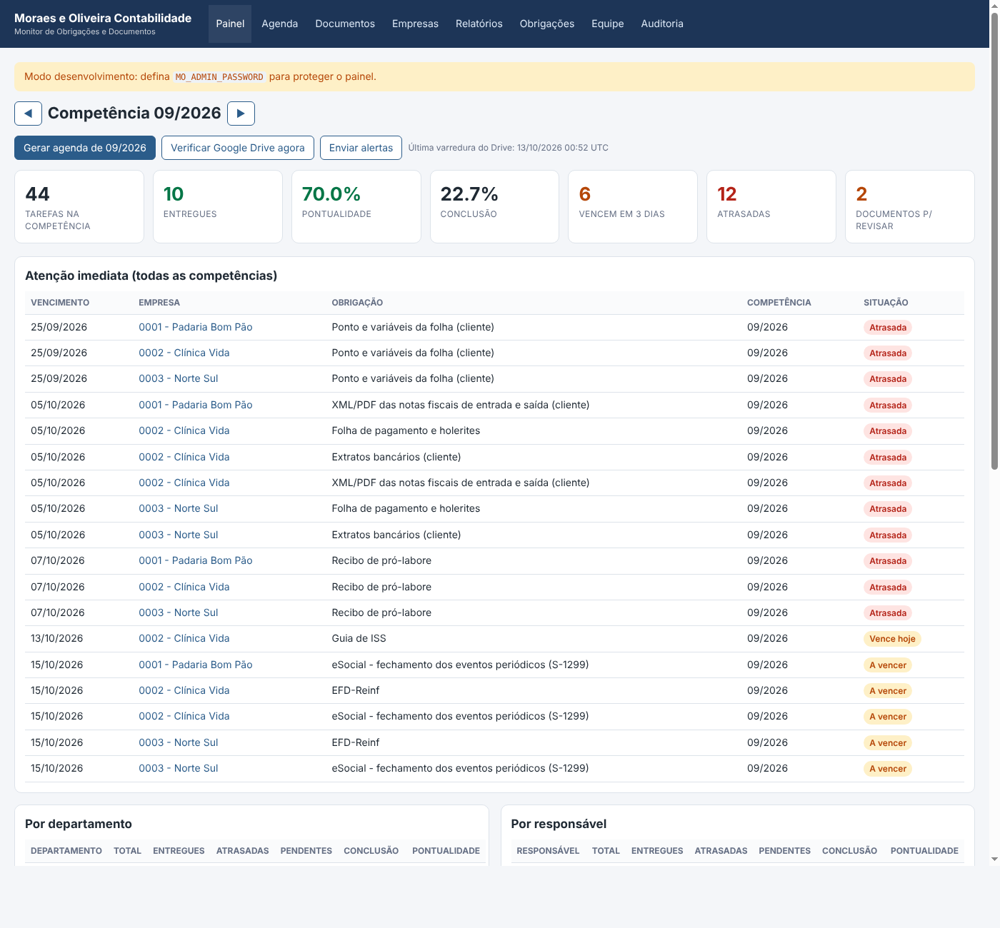

# Moraes e Oliveira Contabilidade: Monitor de Obrigações e Documentos

Sistema que monitora as pastas do **Google Drive** de cada empresa cliente. Ele identifica sozinho os
documentos entregues pelo escritório (recibos, guias, folha) e os depositados pelo cliente (extratos, XML de notas, ponto). Com isso, dá baixa
na agenda de obrigações acessórias e avisa a equipe e o cliente sobre o que está atrasado.



## O que o sistema faz

| Módulo | Função |
|---|---|
| **Agenda de obrigações** | Gera, para cada competência, as tarefas de cada empresa conforme regime (MEI, Simples, Presumido, Real, 3º setor) e perfil (comércio, indústria, serviços, empregados, pró-labore, retenções, saúde, imobiliária). Calcula o vencimento com feriados nacionais, dia útil, antecipação e prorrogação. |
| **Catálogo legal** | 28 obrigações e documentos com prazo, base legal e penalidade: PGDAS-D, DAS, DAS-MEI, DASN-SIMEI, DEFIS, DeSTDA, DCTFWeb/MIT, DARF DCTFWeb, EFD-Reinf, PIS/COFINS, IRPJ/CSLL, EFD-Contribuições, EFD ICMS/IPI, ICMS, ISS, DMED, DIMOB, balancete, demonstrações (NBC TG 26 / NBC TG 1000 / ITG 1000), ECD, ECF, folha, pró-labore, eSocial, FGTS Digital, extratos, XML de notas e ponto. |
| **Monitor do Google Drive** | Varre as pastas de cada empresa a cada N minutos e lê o texto de PDF, XML, OFX, TXT e Google Docs. Classifica cada arquivo (obrigação, competência e CNPJ) e dá **baixa automática**, no prazo ou com atraso, guardando o arquivo como evidência. |
| **Conferência de CNPJ** | Avisa quando um documento de outro cliente foi salvo na pasta errada. |
| **Fila de revisão** | Arquivos que o robô não identificou com segurança são classificados pela equipe em um clique, e a tarefa recebe baixa na hora. |
| **Alertas** | E-mail diário para o gestor e para cada responsável (fiscal, contábil, DP). **Cobrança automática ao cliente** dos documentos que ele deve depositar, no máximo uma a cada 3 dias. Webhook para WhatsApp (Z-API, Twilio, n8n). |
| **Painel e relatórios** | Indicadores de pontualidade, conclusão e risco por departamento, responsável, obrigação e empresa. Matriz obrigação × competência por cliente e exportação CSV para Excel. |
| **Auditoria** | Registro de toda baixa (automática ou manual), dispensa, reabertura, classificação e cobrança. |

## Início rápido (demonstração local, sem Google)

```bash
pip install -r requirements.txt
python -m mo_obrigacoes demo        # cria 4 empresas fictícias e um "Drive" local com documentos
python -m mo_obrigacoes serve       # abre em http://localhost:8000
```

## Produção com Google Drive

Veja **[docs/implantacao.md](docs/implantacao.md)**: conta de serviço no Google Cloud, compartilhamento da
pasta "Clientes", `.env`, importação da carteira e Docker.

```bash
cp .env.example .env                                   # preencha
python -m mo_obrigacoes init
python -m mo_obrigacoes importar scripts/empresas_modelo.csv
python -m mo_obrigacoes agenda --competencia 2026-09
python -m mo_obrigacoes sync --completo                # primeira varredura
docker compose up -d                                   # painel + worker (sync, agenda, alertas)
```

## Documentação

- [Pesquisa de mercado e engenharia reversa funcional dos sistemas líderes](docs/pesquisa-sistemas-obrigacoes.md)
- [Arquitetura e decisões de projeto](docs/arquitetura.md)
- [Guia de implantação](docs/implantacao.md)

## Testes

```bash
python -m pytest -q
```
