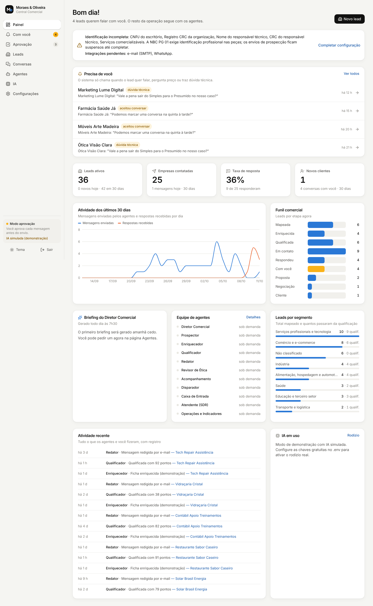

# Central Comercial — Moraes & Oliveira Contabilidade

Sistema que automatiza o setor comercial do escritório: **capta e busca empresas 24 horas por dia, enriquece com dados da empresa e dos sócios, qualifica, escreve e-mails e mensagens de WhatsApp específicos para cada lead, conduz a conversa inicial e só chama você** quando o lead quer falar com uma pessoa, pergunta preço ou traz dúvida técnica.

Construído a partir da skill **equipe-comercial-contabil** (perfis, funil, regras éticas da NBC PG 01 e Resolução CFC 1.590/2020), adaptada para operar sozinha com portões de conformidade.



## Como funciona

```
 Dados Abertos CNPJ ─┐                                                   ┌─► Você (e-mail + WhatsApp + painel)
 Formulário do site ─┤                                                   │    quando o lead pede pessoa,
 WhatsApp receptivo ─┼─► Prospector ─► Enriquecedor ─► Qualificador ─┐   │    preço, dúvida técnica ou reunião
 Importação / manual ┘   (busca 24h)   CNPJ + QSA +    pontuação +   │   │
                                       sócios em       perguntas de  │   │
                                       outras empresas levantamento  ▼   │
                                       + site          Acompanhamento (cadência e-mail → WhatsApp → e-mail)
                                                               │          │
                                                       Redator ─► Revisor de Ética ─► [você aprova] ─► Disparador
                                                                                                         │
                                Caixa de Entrada (IMAP) + webhook WhatsApp ─► Atendente (SDR) ───────────┘
                                                                              classifica a intenção e conversa
          Diretor Comercial: coordena, envia briefing diário · Operações: higiene do funil e lembretes
```

### Os 11 agentes

| Agente | O que faz | Frequência |
| --- | --- | --- |
| **Diretor Comercial** | Coordena a equipe e envia o briefing diário às 7h30 | 30 min |
| **Prospector** | Busca ativa de empresas recém-abertas no seu perfil (Dados Abertos do CNPJ da Receita) | 12 h |
| **Enriquecedor** | Cadastro CNPJ, quadro de sócios (QSA), **outras empresas de cada sócio**, leitura do site, contatos com origem | 3 min |
| **Qualificador** | Pontuação 0–100 com motivo de cada ponto + perguntas de levantamento por segmento | 3 min |
| **Redator** | Escreve cada mensagem **para aquele lead**, citando só fatos da ficha ([F1], [F2]…) | sob demanda |
| **Revisor de Ética** | Barra promessa de economia, preço, superlativo, crítica a colegas, fato inventado | antes de todo envio |
| **Acompanhamento** | Cadência configurável; para na primeira resposta | 5 min |
| **Disparador** | Envia dentro do horário comercial, limites por dia/hora e intervalo mínimo | 1 min |
| **Caixa de Entrada** | Lê respostas de e-mail e liga cada uma ao lead certo | 2 min |
| **Atendente (SDR)** | Classifica a intenção, conversa, coleta fatos e **chama você** | 1 min + tempo real |
| **Operações** | Detecta e-mail/telefone do contador cadastral, aplica bloqueios, relembra pendências | 30 min |

### Quando o sistema chama você

- O lead pede para falar com uma pessoa ou pede ligação.
- O lead pergunta **preço**, valores ou orçamento. A IA nunca cita honorários.
- O lead traz **dúvida técnica** (tributária, fiscal ou trabalhista). A IA não emite parecer.
- O lead aceita reunião.
- A conversa passa do limite de respostas automáticas, ou a IA não entendeu.

Nesses casos, a IA responde "vou passar para o Fábio" e você recebe o aviso por e-mail e WhatsApp. O lead aparece em **Com você** no painel.

### IA gratuita com rodízio automático

São 9 provedores com camada gratuita: Groq, Cerebras, Gemini, OpenRouter, SambaNova, Mistral, GitHub Models, Cloudflare e Ollama local. Basta definir as chaves no `.env`. Quando um provedor esgota a cota diária, os créditos, atinge o limite por minuto ou falha:

1. ele é pausado pelo tempo certo (até a virada do dia, pelo `retry-after` ou por alguns minutos);
2. a mesma tarefa vai imediatamente para o próximo da fila;
3. tudo fica registrado na página **IA**.

O **Ollama local** é a reserva final: não tem limite e os dados não saem do servidor.

A opção **privacidade estrita** vem ligada. Com ela, nomes de sócios e conversas não vão para provedores cuja camada gratuita pode usar os dados para treinar modelos.

## Rodar a demonstração (2 minutos)

Requer Node.js 22.18 ou superior.

```bash
npm install
npm run build          # gera o painel
npm run seed           # cria 42 empresas FICTÍCIAS (contatos .invalid, nada é enviado)
cd server && IA_SIMULADA=1 npm start
# abra http://localhost:3333
```

## Colocar em produção

1. Contrate um servidor pequeno (VPS de 2 GB de RAM; 8 GB se for usar o Ollama) com um domínio, por exemplo `comercial.moraeseoliveira.com.br`, e HTTPS (Caddy ou Nginx).
2. Copie `.env.exemplo` para `.env` e preencha.
3. Rode `docker compose up -d --build`.
4. Em **Configurações**:
   - preencha a **identificação** (CNPJ, CRC e responsável técnico). Sem ela, os envios de prospecção ficam bloqueados;
   - preencha os **serviços**, o **cliente ideal** (UF, municípios, CNAEs) e ative a **busca nos Dados Abertos**.
5. Comece no **modo aprovação**. Revise as primeiras dezenas de mensagens e só depois passe para **automático**.

Guias específicos:
- [docs/WHATSAPP.md](docs/WHATSAPP.md): API oficial, modelo de mensagem e webhook.
- [docs/EMAIL.md](docs/EMAIL.md): SMTP/IMAP, SPF, DKIM, DMARC e aquecimento do domínio.
- [docs/CONFORMIDADE.md](docs/CONFORMIDADE.md): LGPD, CFC e políticas da Meta. **Leia antes de ligar o automático.**

## Estrutura

```
server/          API, agentes e agendador (Node 22 + TypeScript nativo, Fastify, SQLite embutido)
  src/agentes/   um arquivo por agente + instruções (prompts) baseadas na skill
  src/ia/        catálogo de provedores gratuitos e roteador com rodízio
  src/fontes/    CNPJ (BrasilAPI → CNPJ.ws → ReceitaWS), Dados Abertos da Receita, site
  src/canais/    e-mail (SMTP/IMAP) e WhatsApp (API oficial ou Evolution)
  test/          23 testes, incluindo o fluxo ponta a ponta
web/             painel (React + Tailwind + Recharts), tema claro e escuro, responsivo
```

Comandos: `npm test`, `npm run typecheck`, `npm run build`, `npm run dev` (servidor e painel com recarga automática).

## Limites honestos

- **Dados dos sócios.** O sistema usa o QSA público, as outras empresas do sócio (Dados Abertos), o site da empresa e **o que o próprio lead conta na conversa**. Esse último dado é extraído automaticamente pela IA e é o mais valioso, porque é dado de primeira mão. O sistema **não** consulta CPF, bases compradas ou vazadas, nem raspa redes sociais pessoais: além de proibido pela LGPD e pelos termos dessas plataformas, colocaria o registro do escritório em risco.
- **WhatsApp ativo.** Pela API oficial, o primeiro contato só pode ser feito com modelo aprovado pela Meta. Por padrão, o sistema só inicia conversa no WhatsApp com quem autorizou ou já falou com o escritório. Os demais recebem e-mail. Disparo em massa para números frios leva ao banimento do número.
- **IA gratuita** tem limites que mudam sem aviso. O rodízio absorve isso, mas para volume alto vale manter o Ollama local como reserva.
- **Conformidade:** os portões ajudam, mas não substituem a responsabilidade do contador responsável. Confirme a vigência das normas citadas no site do CFC.
