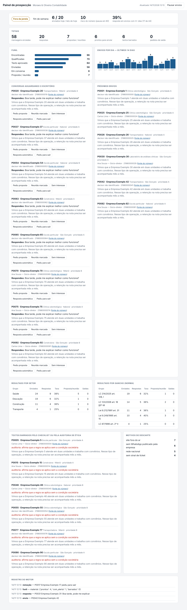

# Prospecção ativa para escritório de contabilidade

Ciclo completo, da leitura do site do escritório até a fila diária de WhatsApp:

| Etapa | Comando | O que faz |
|---|---|---|
| 1 | `nichos` | Lê o site do escritório e define os nichos que ele atende, com termos de busca |
| 2 | `buscar` / `importar` | Acha empresas dos nichos na região (Google Places API oficial) ou importa um CSV |
| 3–4 | `qualificar` | Lê o site de cada empresa, comprova sinais de honorário, coleta o WhatsApp **publicado por ela** e identifica o decisor (sócio, diretor, financeiro) |
| 5 | `material` | Prepara as dores do decisor e o texto único da empresa, com a norma conferida |
| 6 | `fila` | Gera a página do dia com um botão por empresa — **uma pessoa confere e envia** |
| 7 | `enviado`, `resultado`, `relatorio` | Registra envio e resposta; compara taxa por gancho e por setor |
| tudo | `servidor` | **Modo automático**: funil, envio pela Evolution API, respostas e painel |

## Instalação

```bash
pip install -r requirements.txt
cp config.exemplo.json config.json      # preencha site, cidade, CRC e região
export ANTHROPIC_API_KEY=...            # etapas 1, 3–4 e 5
export GOOGLE_MAPS_API_KEY=...          # etapa 2 (Places API); dispensável se usar 'importar'
```

## Uso diário

```bash
python -m prospeccao nichos
python -m prospeccao buscar --setor laboratório --max 40
python -m prospeccao qualificar --limite 25
python -m prospeccao material --limite 25
python -m prospeccao fila               # abre dados/fila-AAAA-MM-DD.html no navegador
python -m prospeccao enviado P0001      # depois de enviar cada mensagem
python -m prospeccao resultado P0001 positiva --notas "pediu proposta"
python -m prospeccao relatorio
```

Sem a chave do Google, gere o CSV com o [gosom/google-maps-scraper](https://github.com/gosom/google-maps-scraper)
e rode `python -m prospeccao importar resultado.csv --setor Saúde --municipio "Itaboraí"`.

A base fica em `dados/base.csv` (abre no Excel). Texto com alerta não entra na fila: corrija
`o_que_vimos` / `a_conta` na planilha e rode `python -m prospeccao revisar`.

## Modo automático

```bash
python -m prospeccao servidor
```

Um processo só faz tudo: mantém o funil cheio (nichos → busca → qualificação → material), envia
pelo WhatsApp, trata as respostas e serve o painel em `http://127.0.0.1:8787/?t=<token>`.



**Pré-requisitos**

1. [Evolution API](https://github.com/evolution-foundation/evolution-api) rodando, com uma instância
   conectada ao número do escritório (QR code). Preencha `evolution` em `config.json`.
2. Webhook da instância apontando para `http://<host>:8787/webhook/<token>`, com os eventos
   `MESSAGES_UPSERT` e `CONNECTION_UPDATE`. Sem ele o sistema não vê resposta nem pedido de saída —
   não ligue o envio automático sem o webhook.
3. `painel.token` trocado por um texto longo e aleatório. O servidor escuta só em `127.0.0.1`;
   para acessar de fora, ponha atrás de um proxy com HTTPS.

**Ética sem leitura humana.** Como ninguém lê o texto antes de sair, ele passa por duas barreiras:
o checklist determinístico (abaixo) e uma auditoria por um segundo prompt, que confere a NBC PG 01
(itens 11 a 15), cada fato contra o site da empresa e cada norma contra a base conferida. Texto
reprovado é refeito uma vez; reprovado de novo, fica **barrado** e aparece no painel — nunca é enviado.

**Travas contra bloqueio do número** (`prospeccao/whatsapp.py`; mecânica inspirada no
[kobie3717/baileys-antiban](https://github.com/kobie3717/baileys-antiban), com tetos menores porque
aqui todo envio é primeiro contato):

| Trava | Padrão | Chave em `whatsapp` |
|---|---|---|
| Rampa de aquecimento do número | 5, 5, 8, 8, 10, 12, 15, 15, 18, 20 por dia | `rampa` |
| Teto diário depois da rampa | 20 | `teto_dia` |
| Teto por hora | 4 | `max_por_hora` |
| Intervalo sorteado entre envios | 9 a 22 minutos | `intervalo_min` |
| Janela | segunda a sexta, 9h–18h, fora de feriado | `hora_inicio`, `hora_fim`, `feriados_extras` |
| Número conferido antes do envio | existe no WhatsApp? | — |
| Monitor de risco | falha +20, HTTP 403 +40, 401 +60, queda de conexão +15; pausa em 60 | `risco_pausa` |
| Guarda de resposta | pausa se menos de 5% responderem em 20 envios | `resposta_minima`, `amostra_resposta` |
| Pedido de saída | removido na hora, com confirmação, em todos os canais | — |

Quando o motor pausa por risco, ele **não volta sozinho**: alguém lê o motivo no painel e decide.
Esse é o único ponto que continua humano, junto com responder quem respondeu ("Conversas
aguardando o escritório") — a partir da resposta, a conversa é do contador, não do robô.

**O limite que nenhuma trava remove.** Os termos do WhatsApp proíbem mensagem automatizada ou em
massa para quem não pediu contato, por qualquer API não oficial e em qualquer volume. As travas
reduzem a chance de bloqueio; não a eliminam, e o que mais pesa é o destinatário denunciar ou
bloquear. Por isso:

- use um número **dedicado à prospecção**, nunca o que atende os clientes atuais;
- não suba os tetos por conta própria — 20 primeiros contatos por dia já é agressivo;
- o sistema não simula digitação, não troca de número nem usa proxy para esconder a automação:
  isso não reduz denúncia e só agrava a punição quando detectado.

O modo manual continua disponível (`fila` + `enviado`), para quem quiser conferir cada envio.

## O que o texto nunca contém

O checklist (`prospeccao/etapas.py`, `PROIBIDOS`) barra antes da fila:

- trabalho gratuito, diagnóstico, "sem compromisso";
- recuperação, restituição ou ressarcimento de valores;
- preço, honorário ou promessa de economia;
- menção ao contador atual (NBC PG 01, itens 11 a 15);
- norma que não esteja em `prospeccao/conhecimento/dores-por-setor.md` — a base de normas já
  conferidas na fonte. Para usar uma norma nova, confira no Planalto/órgão emissor e acrescente lá;
- norma revogada (CPC 17 — o vigente para contrato de obra é o CPC 47 / NBC TG 47).

A assinatura com CRC e a frase de saída são acrescentadas pelo sistema, não pela IA.

## LGPD

Base legal: legítimo interesse (Lei 13.709/2018, art. 7º, IX), para contato B2B com dado que a
empresa publicou como canal comercial. A planilha guarda, por lead, o contato usado, a URL de
origem, a data, o texto enviado e a resposta. Não entram: telefone ou e-mail do cadastro da
Receita, dado pessoal fora do contexto empresarial, base comprada.

## Testes

```bash
python -m unittest discover -s tests
```
